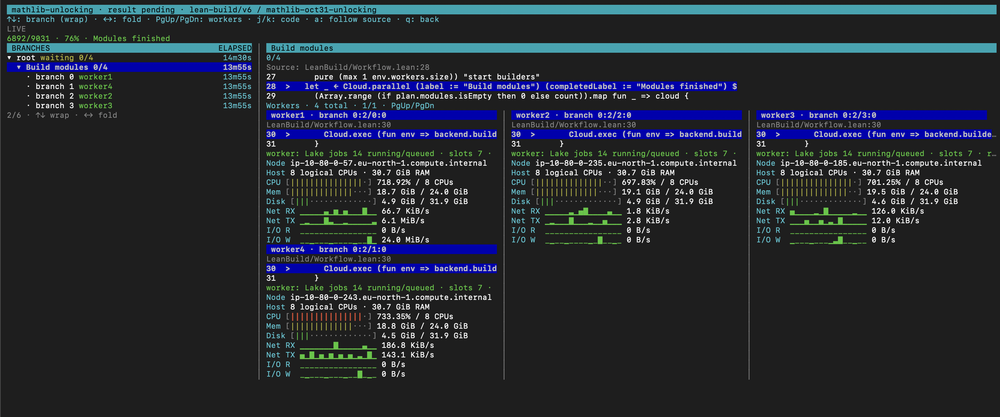

# Build Mathlib on AWS

Build a pinned Mathlib revision from source, watch the workers in the cloud
console, and remove the test environment when finished. The shell helpers manage
deployment; the console connects to the scheduler over HTTP.

This walkthrough uses the configuration tested on 31 October 2026:

| Resource | Configuration |
| --- | --- |
| EC2 machines | Four `m7g.2xlarge`: 8 ARM64 cores and 32 GiB RAM each |
| Cloud workers | Four, each with an 8-CPU budget and 24 GiB memory limit |
| Compilation | Seven slots per worker, 28 in total |
| Scheduler | One, sharing a machine; 250m CPU request and 1 GiB memory limit |
| Durable node disks | 100 GiB each, including the scheduler |
| Shared artifacts | S3 |

The [request](mathlib.json) pins Mathlib commit
`56a005855ea17e0b0958f73ec801ae140b0a1679`, whose
[toolchain](https://github.com/leanprover-community/mathlib4/blob/56a005855ea17e0b0958f73ec801ae140b0a1679/lean-toolchain)
is Lean **4.35.0**. It builds the `Mathlib` target with downloaded build caches
disabled. The tested run built **9,031 modules in 25m27s**, excluding cluster
provisioning, image building, and worker startup. Treat this as an observation,
not a completion-time guarantee.

## 1. Prepare your machine and AWS account

Run all shell commands from the **lean-cloud repository root**. Install the
[local prerequisites](../../deploy/README.md#local-docker) and the
[AWS deployment tools](../../deploy/AWS.md#1-check-tools-and-sign-in).
Docker must be running. On an x86 host, the Docker builder also needs ARM64
emulation; [Docker Desktop includes it](https://docs.docker.com/build/building/multi-platform/#qemu).

The account needs the permissions described in the AWS guide and **32 available
On-Demand Standard vCPUs** in the selected region, in addition to any existing
usage. Check [EC2 service quotas](https://docs.aws.amazon.com/AWSEC2/latest/UserGuide/ec2-resource-limits.html)
before provisioning. This creates paid resources; use the cleanup steps below
when finished.

```sh
./deploy/aws.sh doctor
./deploy/aws.sh login lean-cloud --region eu-north-1
```

Complete sign-in yourself. The remaining commands use that AWS CLI session.
The examples use profile `lean-cloud` and Stockholm (`eu-north-1`); substitute
your profile and supported region in both `login` and `init` if needed.

## 2. Build the application image

```sh
DOCKER_DEFAULT_PLATFORM=linux/arm64 \
  ./Applications/LeanBuild/build.sh lean-cloud-build:mathlib 4.35.0
lake build lean_cloud
```

The first command builds the LeanBuild scheduler/worker image in your local
Docker image store. `DOCKER_DEFAULT_PLATFORM` selects ARM64 for both build
stages, matching the Graviton machines (see
[Docker's platform setting](https://docs.docker.com/reference/cli/docker/#environment-variables)).
Workers download and cache the pinned Lean toolchain on their first startup.
The second command builds the local console. Neither command creates AWS resources.

## 3. Create the cluster

Use fresh `.mathlib-infra` and `.mathlib-deployment` directories and an unused
cluster name. Replace `YOUR_PUBLIC_IPV4/32` with your administrator machine's
public IPv4 address followed by `/32`. The helper does not discover it for you.

```sh
./deploy/aws.sh init .mathlib-infra --name mathlib-demo \
  --profile lean-cloud --region eu-north-1 \
  --admin-cidr YOUR_PUBLIC_IPV4/32 \
  --machines 4 --machine-size m7g.2xlarge --os-disk-gib 32
./deploy/aws.sh show .mathlib-infra
./deploy/aws.sh plan .mathlib-infra
```

Review the plan, then create the resources:

```sh
./deploy/aws.sh create .mathlib-infra
```

This provisions EKS, its four machines, ECR, S3, and the required identities and
networking. It saves Kubernetes credentials and prepares the EBS StorageClass.
Keep `.mathlib-infra`: it contains the state needed for cleanup. If `create`
fails after allocating resources, clean them up using `destroy-plan` and
`destroy` from step 7.

## 4. Publish and configure four workers

```sh
./deploy/aws.sh publish .mathlib-infra lean-cloud-build:mathlib mathlib-v1
./deploy/aws.sh configure .mathlib-infra .mathlib-deployment mathlib-v1 4
```

Set the resource budgets **before the first `up`**:

```sh
jq '.cpuMillis = 8000 |
    .cpuRequestMillis = 7000 |
    .memoryMiB = 24576 |
    .diskGiB = 100 |
    .startupSeconds = 900 |
    .schedulerResources = {cpuMillis: 250, memoryMiB: 1024}' \
  .mathlib-deployment/deployment.json > .mathlib-deployment/deployment.next.json
mv .mathlib-deployment/deployment.next.json .mathlib-deployment/deployment.json

./deploy/kubernetes.sh render .mathlib-deployment
./deploy/kubernetes.sh show .mathlib-deployment
./deploy/kubernetes.sh up .mathlib-deployment
./deploy/kubernetes.sh status .mathlib-deployment
```

Kubernetes places one large worker on each machine and the small scheduler
alongside one of them. The worker advertises eight CPUs to LeanBuild, which uses
seven compilation slots and leaves one CPU's capacity for coordination and IO.
The seven-CPU placement request lets it fit alongside Kubernetes services; it
does not subtract another CPU from the execution budget. See
[worker resource budgets](../../deploy/README.md#worker-resource-budgets).

Wait for one scheduler and four workers to become ready. First startup may take
several minutes while the workers install their toolchains. The image tag is
pinned to a digest in the deployment; use a fresh tag and deployment for changed
application code.

## 5. Connect and watch the build

In one terminal, keep the private connection running:

```sh
./deploy/kubernetes.sh connect .mathlib-deployment 8081
```

In a second terminal, from the same repository root:

```sh
lake exe lean_cloud
```

Enter these commands **separately** at the `cloud>` prompt:

```text
connect mathlib-demo http://127.0.0.1:8081 --token-file .mathlib-deployment/client.token
programs
run lean-build --input Applications/LeanBuild/mathlib.json --id mathlib
watch mathlib
```

`programs` should list `lean-build/v6`. The request is a small JSON file; workers
fetch Mathlib and its dependencies themselves. No local Mathlib checkout or
build artifacts are uploaded.



Use **right arrow** to expand `Build modules`, then **up/down** to select a
branch. The parallel group shows all workers; a branch focuses on its worker.
**PgUp/PgDn** pages through worker cards, and **q** returns to the prompt.
The top counter reports finished modules. `0/4` on the parallel group counts
finished builder sessions; those long-lived sessions remain active while modules
are being built. CPU **100% means one core**, so roughly 700% means seven cores
are busy.

Use `ps` for run status and `top` for the deployment's resource view. The console
can be closed without stopping the build. If the tunnel disconnects, rerun
`kubernetes.sh connect`; the workflow continues on AWS. `127.0.0.1:8081` is your
local tunnel endpoint; the scheduler has no public application port. Use a new
connection name if `mathlib-demo` already identifies an older deployment.

## 6. Read the result

When `ps` shows the run completed, leave the console with `quit` and save the
report from your shell:

```sh
lake exe lean_cloud result mathlib > .mathlib-deployment/mathlib-report.json
jq '{success, commit, toolchain,
     modules: (.modules | length),
     built: ([.modules[] | select(.status == "built")] | length),
     finalTarget: .build.status}' .mathlib-deployment/mathlib-report.json
```

For this pinned request, expect `success: true`, **9,031** built modules and
`finalTarget: "built"`. A completed Cloud workflow can still report a build
failure, so check `success`. The report includes module diagnostics and a
`build.artifacts` reference to the complete workspace in S3; see
[build results](README.md#build-results).

To repeat the experiment, use a new run ID. A repeat on these same workers may
reuse local toolchains and caches, so it is not the same as a fresh-machine test.
The request's one-hour limit applies to preparation, to the final Lake
invocation, and to each wait for the next module to finish; fewer workers take
longer rather than failing. It is not an automatic AWS cleanup timer.

## 7. Clean up

Save any artifacts you need first. The local JSON report contains references;
it does not contain the compiled workspace. Cleanup deletes the deployment's
workflows, disks, images, and S3 artifacts.

```sh
./deploy/kubernetes.sh clean .mathlib-deployment --yes
./deploy/aws.sh destroy-plan .mathlib-infra
# Review the deletion plan.
./deploy/aws.sh destroy .mathlib-infra
```

Keep this order: the Kubernetes cleanup needs the running EBS controller to
delete application disks. `destroy` then removes the infrastructure and bucket.
Keep local state until the helpers confirm cleanup succeeded. Stop the tunnel
with **Ctrl-C** afterward.

Closing the console, killing a workflow, or stopping pods does **not** remove
AWS resources or stop their ongoing charges.
