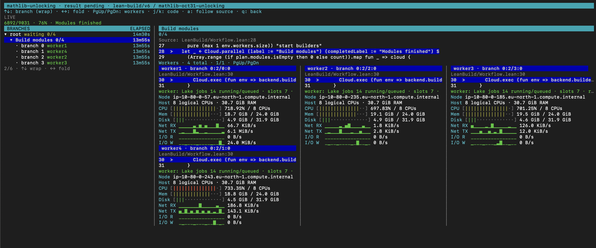

# lean-cloud

[](https://github.com/palladin/lean-cloud/actions/workflows/ci.yml)
[](https://leanprover.github.io/)
[](LICENSE)

Parallel and distributed programming for Lean using composable monadic programs.

Write workflows with `cloud { ... }`, run independent computations with
`Cloud.parallel`, and combine their results using ordinary Lean code. Parallel
branches can use variables from their surrounding scope. The same workflow runs
on local workers or in the cloud.

For example, count error lines across log files in shared blob storage:

```lean
import LeanCloud

open LeanCloud

def summarizeLogs (files : Array String) : Cloud IO BlobRef := cloud {
  let counts ← Cloud.parallel (files.map fun name =>
    Cloud.exec fun env => do
      let text ← env.blobs.readTextByName name
      return ((text.splitOn "\n").filter (·.startsWith "ERROR")).length)

  let total := counts.foldl (· + ·) 0
  Cloud.exec fun env => env.blobs.putText s!"files={files.size}, errors={total}\n"
}
```

Each branch reads one file and counts its errors. The workflow combines the
counts and saves a report. Its type, `Cloud IO BlobRef`, tells us that the result
is a reference to that report in blob storage.

## Cloud console

Connect the console to a deployed scheduler to run programs and follow their
progress. `watch` shows the branch tree, executing code, and worker resource use.
Local Docker, Azure, and AWS use the same console commands.

```text
cloud> connect mathlib-demo http://127.0.0.1:8081 --token-file .mathlib-deployment/client.token
cloud> programs
cloud> run lean-build --input Applications/LeanBuild/mathlib.json --id mathlib
cloud> watch mathlib
```

Building Mathlib on four AWS workers:



Follow the [AWS Mathlib walkthrough](Applications/LeanBuild/MathlibAWS.md) to
set this up, or see the [console guide](LeanCloud/Console.md) for all commands.

## Applications

- [LeanBuild](Applications/LeanBuild/README.md): build Lean projects from GitHub
  across workers, using Lake's local parallelism.
- [Cube-and-conquer SAT](Applications/CubeAndConquer/README.md): split a CNF
  problem, solve it in parallel, and check the resulting models or proofs.
- [Wiki](Applications/Wiki/README.md): count words and search Wikipedia dumps
  using composable cloud reducers.

## Get started

- [Run locally with Docker](deploy/README.md#local-docker)
- [Deploy and run the example on Azure](deploy/Azure.md)
- [Deploy and run the example on AWS](deploy/AWS.md)
- [Run your first log-processing workflow](deploy/README.md#run-the-log-processing-example)

## How it works

- [Proofs](LeanCloud/Proofs/README.md): for pure cloud programs, sequential,
  parallel and crash-restarting replay return the same result as direct execution.
- [Worker recovery](LeanCloud/ReplayRecovery.md) and
  [scheduler simulation](LeanCloud/Simulation.md).
- [Deployment model](LeanCloud/Deployment.md): durability, scaling and credentials.
- [Tests](LeanCloudTests/README.md): run `lake build` for the library and proofs,
  then `lake test`.

## Repository layout

| Directory | Contents |
| --- | --- |
| `LeanCloud/` | The `Cloud` monad, interpreters, scheduler model and proofs |
| `LeanCloudCli/` | The `lean_cloud` console |
| `runtime/` | Deployed scheduler and worker processes: HTTP mailboxes, SQLite, S3/Azure blob storage, and the demo registry that ships as `cloud-app` |
| `reducers/` | [Cloud reducers](reducers/README.md) for tree-shaped aggregation |
| `Applications/` | [Example applications](Applications/README.md) |
| `deploy/` | [Deployment helpers](deploy/README.md) for Docker, Kubernetes, Azure and AWS |
